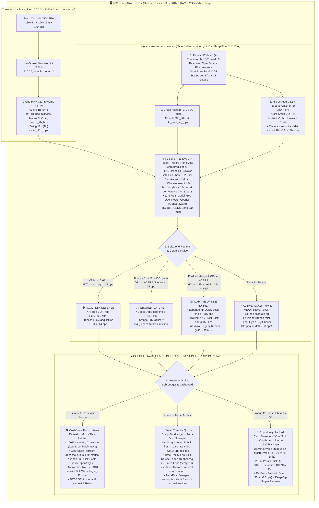

# ⚡ TRE OS v7.7 (SOVEREIGN PREDATOR EDITION) • AUTONOMOUS FLUID MULTI-HORIZON MICROSTRUCTURE & LOCAL KRONOS-MINI QUANT OS (OKX SPOT EEA)

**TRE OS v7.7 — Sovereign Predator Edition** (`openclaw-trader`) è il sistema operativo quantitativo autonomo progettato per **OKX Spot (Area EEA, Zero Leva, `tdMode: cash`, Rischio Liquidazione Zero, Esecuzione 100% Post-Only Maker `0.00% Fee`)**.

Nella versione **v7.7 Sovereign**, l'intero stack (incluso il Foundation Model finanziario **`NeoQuasar/Kronos-mini` da 4.1M parametri** con previsioni **Triplo-Orizzonte `5m + 15m + 1H`** a bassa varianza `T=0.35`, il **Cervello Fluido Multi-Orizzonte** e il nuovo **Institutional Web Terminal React/TypeScript/Tailwind**) gira **al 100% dentro una singola Mini-VPS Linux (`brody`, `< 680 MB RAM` complessivi, costo aggiuntivo `$0`)** senza alcuna dipendenza da server GPU esterni, mantenendo come mandato inviolabile la **Regola Aurea di Compounding Organico Giornaliero (`+0.70%` ↔ `+5.00%` al giorno)** fino al **31 Dicembre 2026**.

---

## 🗺️ SCHEMA DECISIONALE COMPLETO (ARCHITETTURA & CERVELLO FLUIDO A 15 SECONDI)



---

## 🏆 EVOLUZIONI ARCHITETTURALI DI TRE OS v7.0 (SOVEREIGN EDITION)

| Modulo / Funzione | Precedente v6.0 | ⚡ Nuovo TRE OS v7.0 (Sovereign Predator) |
| :--- | :--- | :--- |
| **Oracolo AI K-Line** | Dipendente da VPS GPU esterna | **100% Locale su `brody` (`127.0.0.1:8090`) con `NeoQuasar/Kronos-mini (4.1M)`, Pre-Warmer in background (`0.00ms` latenza HTTP) e Doppio Orizzonte (`5m` + `15m`)** |
| **Universo Spot OKX EEA** | 8 Token statici | **12 Coppie Dinamiche:** 10 Attive Ultra-Liquide (**`HYPE`, `ZEC`, `SOL`, `SUI`, `NEAR`, `UNI`, `XRP`, `LINK`, `RENDER`, `AVAX`**) + 2 in **`Harvest & Retire` (`FET`, `SEI`)** |
| **Latenza Scansione Mercato** | Sequenziale (`~5.45s` per 13 coppie) | **Parallela a 6 Thread (`ThreadPoolExecutor`, `~0.85s` per leggere 13 OrderBook L2 + 13 Trade Tape)** |
| **Protezione Crash Macro** | Solo VPIN singolo token | **Cross-Asset `BTC-USDC` Lead-Lag Radar:** attiva `TOXIC_DIP_DEFENSE` su tutto il portafoglio se `BTC` scarica (`< -12 bps`) |
| **Rotazione Capitale Veloce** | Media globale `openAvgPx` | **`Fresh Tranche Quick-Scalp Sub-Ledger` (`+35..+65 bps` TP indipendente + `+28 bps` Profit-Lock) + `Anti-Stacking Guard` (`$17.50` max/token)** |
| **Sblocco Posizioni Storiche** | Attesa passiva | **`100% Inventory Coverage` (zero frazioni libere) + `Ratchet Capital Recycler` (usa il 20% dei profitti realizzati per abbassare e sbloccare il TP storico più vicino)** |
| **Consiglio & Audit LLM** | Singolo endpoint | **Multi-Model Free OpenRouter Rotation (`openrouter/free`, `nemotron-ultra-253b:free`, `deepseek-r1:free`, `llama-3.3-70b:free`)** |

---

## 🧠 GUIDA PER L'UTENTE: INSTALLAZIONE 1-CLICK DI KRONOS (`Kronos-mini` 4.1M o `Kronos-small` 24.7M)

**TRE OS v7.0** include lo script universale `scripts/install_kronos_oracle.sh` per installare il Foundation Model finanziario **[shiyu-coder/Kronos](https://github.com/shiyu-coder/Kronos)** direttamente sulla propria Mini-VPS CPU (`Kronos-mini` 4.1M) o su macchina GPU/Mac (`Kronos-small` 24.7M):

```bash
cd ~/openclaw-trader

# 1. Per Mini-VPS solo CPU (1 GB RAM + 2 GB Swap) -> Installa Kronos-mini (4.1M, ~16 MB di pesi):
bash scripts/install_kronos_oracle.sh --size mini

# 2. Per Server con GPU CUDA o Mac Apple Silicon -> Installa Kronos-small (24.7M):
bash scripts/install_kronos_oracle.sh --size small
```

Il servizio `kronos-oracle.service` mantiene pre-calcolate in RAM le previsioni `5m` (1h) e `15m` (2h) di tutte le 12 coppie e risponde su `http://127.0.0.1:8090/forecast` in **`0.00 ms`**.

---

## 🚀 INSTALLAZIONE 1-CLICK DELL'INTERO SISTEMA

```bash
curl -fsSL https://raw.githubusercontent.com/glaucogaribaldi/openclaw-trader/main/install.sh | bash
```

---

*Gestito ed auditato autonomamente h24 da Lehman Brody su VPS `brody` (Debian 13 Trixie, Python 3.13.5, SQLite3 WAL).*
