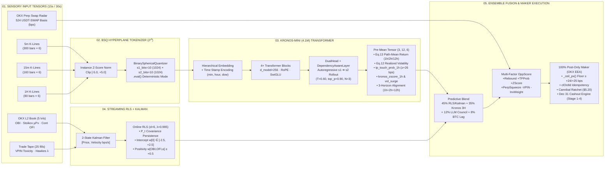

# 🧠 TRE OS v8.7 — Neural & Microstructure Architecture Map (`NeoQuasar/Kronos-mini` + Online RLS + Kalman)

**Document ID:** `TRE-OS-V8.7-NEURAL-ARCH-2026-10-25`  
**Interactive Live Visualizer:** Available natively on `http://34.28.19.242:8080` (**Tab `02. Neural Brain & Kronos`**)  
**Foundation Model Reference:** Shi et al., *"Kronos: A Foundation Model for the Language of Financial Markets"*, Tsinghua University (`arXiv:2508.02739v1`)

---

## 1. End-to-End Hybrid Neural & Microstructure Topology (Mermaid)

---

## 2. PyTorch Layer-by-Layer Architecture of `NeoQuasar/Kronos-mini (4.1M)`

Inspected directly from `/home/zavattoni_giacomo/Kronos/model/kronos.py` and `/home/zavattoni_giacomo/Kronos/model/module.py`:

| Stage | Module Name | Input Shape | Output Shape | Key Parameters & Mathematical Role |
| :---: | :--- | :---: | :---: | :--- |
| **01** | `InstanceNorm + Clip` | `(B, T, 6)` | `(B, T, 6)` | Per-window mean/std normalization of `[open, high, low, close, volume, amount]`, clipped to `[-5.0, +5.0]`. |
| **02** | `KronosTokenizer.embed` + `enc_layers` (`3× TransformerBlock`) | `(B, T, 6)` | `(B, T, 256)` | Projects 6D K-line features into `d_model = 256` latent representation. |
| **03** | `BSQuantizer` (`BinarySphericalQuantizer`) | `(B, T, 256)` | `s1: (B, T)`, `s2: (B, T)` | Projects latent vectors onto the `20D` unit hypersphere (`s1_bits=10` coarse sub-token `[0..1023]`, `s2_bits=10` fine residual sub-token `[0..1023]`). |
| **04** | `HierarchicalEmbedding` + `TemporalEmbedding` | `s1, s2: (B*N, T)` | `(B*N, T, 256)` | Combines `s1/s2` token embeddings with calendar embeddings (`minute`, `hour`, `weekday`, `day`, `month`). |
| **05** | `Kronos.transformer` (`4× TransformerBlock`) | `(B*N, T, 256)` | `(B*N, T, 256)` | Causal self-attention with **Rotary Position Embeddings (`RoPE`)**, `RMSNorm`, and `SwiGLU` feed-forward networks. |
| **06** | `DualHead.head_s1` ➔ `DependencyAwareLayer` ➔ `DualHead.head_s2` | `(B*N, T, 256)` | `logits_s1 (1024)`, `logits_s2 (1024)` | First samples coarse sub-token `s1` (`T=0.60, top_p=0.90`), conditions on `s1` via cross-attention, then samples fine sub-token `s2`. |
| **07** | `_predict_paths_pre_mean` (`KronosTokenizer.decode`) | `s1, s2` rollouts | **`raw_paths: (N=3, H=12, 6)`** | Decodes all `N=3` trajectories **before** `np.mean(axis=0)` to preserve full path distribution (`tp_touch_prob_1h`, `pred_volatility_1h_bps`, `kronos_zscore_1h`). |
